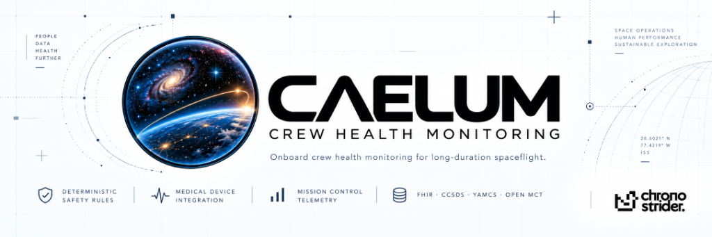
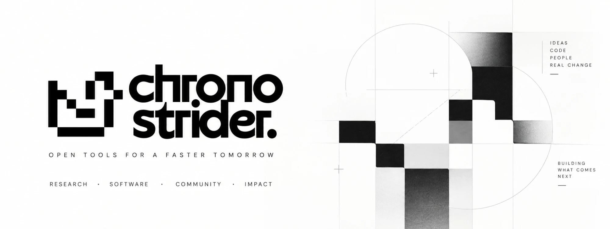

<p align="center">
  
</p>

<div align="center">

# CAELUM

**Onboard crew health monitoring for long-duration spaceflight**

*A desktop health station for the crew: it watches every crew member, raises alarms that cannot
be missed, and keeps mission control informed, even with no link to Earth.*

Rust core · Tauri 2 · React 19 · CCSDS · XTCE · Yamcs · Open MCT · HL7 FHIR R4

</div>

---

## The idea

On a mission to the Moon or Mars there is no ambulance and often no live link to a doctor.
The crew has a crew medical officer (CMO), a set of medical devices, and minutes, not hours,
when something goes wrong.

CAELUM is the health station that sits on a crew laptop and makes that situation safe. It:

- **connects** the crew's wearables and medical devices: chest straps, oximeters, blood-pressure
  cuffs, thermometers, ECG patches, a sensor shirt and wristband, ultrasound, and ECG files;
- **understands** the signals: heart rate from the ECG, breathing from chest bands, pulse from
  optical sensors, core temperature, activity and sleep, each with its signal quality;
- **decides** with deterministic, signed safety rules. A low SpO₂, an asystole or a fever raises
  an alarm by the same rule, every time;
- **escalates** to the affected astronaut, then the CMO, then the whole crew, then the ground,
  until someone acknowledges;
- **informs** mission control with status telemetry, and gives the flight surgeon the full medical
  record, through standard space and health-care interfaces;
- **keeps working** with no link to Earth, for weeks, and never sends a command to the spacecraft
  or to a therapeutic device.

> **Honesty by design.** CAELUM never shows a number it does not have. A missing value is
> **NO DATA**, an old one is **STALE**, and a noisy one is **SIGNAL UNUSABLE**. Every value
> carries its source, time and quality.

---

## What it does

| Area | Capabilities |
|---|---|
| **Crew vitals** | Live vital signs with source device and time; live ECG; trends with each astronaut's personal baseline band |
| **Alarms** | Absolute limits, persistence and hysteresis, spot-check confirmation, asystole detection, signal-quality gating, timed escalation, silence limits, acknowledgement, alarm reports |
| **Devices** | Bluetooth health devices (heart rate, SpO₂, blood pressure, temperature, weight, glucose), IEEE 11073 GHS ECG, the CAELUM sensor shirt and wristband, USB/serial, a plug-in SDK for vendor decoders |
| **Medical** | Crew overview, encounters (SOAP) with sign-off, medication and medical-kit log, protocol checklists linked to alarms, daily check-in, reaction-time test (PVT), schedule of checks |
| **Clinical files** | DICOM images and ultrasound with a viewer and windowing; 12-lead and long ECG review with calipers; EDF/EDF+, HL7 aECG, SCP-ECG and FHIR R4 import; EDF+, CSV and FHIR export; encrypted attachment store |
| **Environment** | Cabin CO₂, O₂, pressure, temperature, humidity, radiation dose and exercise from the vehicle (read-only), shown on one time axis with physiology |
| **Ground** | Status telemetry to mission control; medical summaries and alarm event packets to the flight surgeon in contact windows; ground console with flight-surgeon and BME views and the private medical conference record |
| **Crew stations** | Primary and standby instances with automatic takeover; secondary displays and wall-mounted kiosks on the crew network |
| **Models** | Advisory machine-learning models (signal quality, rhythm, sleep, stress, BP trend, personal-baseline anomaly) that inform but never override the safety rules |

---

## High-level architecture

```
   Wearables & medical devices                    Spacecraft (cFS, read-only)
   BLE health profiles · GHS ECG · sensor kit      CO₂ · O₂ · pressure · radiation
   serial/HID · DICOM / ECG / FHIR files           exercise · vehicle time
                 │                                          │
                 ▼                                          ▼
 ┌───────────────────────────── CAELUM instance ─────────────────────────────┐
 │                                                                            │
 │  devices ─► ingest ─► signal processing ─► ALARM ENGINE ─► escalation ─────┼──► every crew station
 │  (decode)   (units,     (QRS, SQI, HR,      (signed,        (astronaut,     │    (always audible)
 │             time,        respiration,        deterministic   CMO, crew,     │    + wristband
 │             quality)     activity, temp)     rules)          ground)        │
 │                                                                            │
 │  encrypted record (SQLCipher) · signed audit chain · advisory models (ONNX) │
 └───────┬──────────────────────────────┬───────────────────────────┬─────────┘
         │ A · medical record           │ B · operational status     │ crew network (mTLS)
         ▼ HL7 FHIR R4                  ▼ CCSDS telemetry, no        ▼
  Onboard medical data system             physiology                standby instance,
  ⇄ ground medical record         Spacecraft → ground → Yamcs        secondary displays,
         ▲                         → Open MCT consoles               kiosks
         │
         └── A′ · medical summaries and alarm event packets by CFDP in contact windows
                                          │
                                          ▼
                          CAELUM ground console (flight surgeon, BME)
```

**Three paths, one rule: alarms never wait for a link.**

- **Path A, medical record.** Complete clinical data goes to the onboard medical data system over
  HL7 FHIR R4. If that system is unreachable, everything is kept and sent later. Read-back data
  is evaluated like any other reading.
- **Path B, operational status.** Small status and alarm telemetry goes directly to the
  spacecraft as telemetry-only CCSDS packets. It carries **no physiology**: mission control sees
  that crew member 2 has a critical cardio alarm at stage 4, never the values.
- **Path A′, ground downlink.** Medical summaries and alarm event packets go to the flight
  surgeon. They are signed, kept through loss of signal, and sent inside contact windows, with
  files by CFDP.
- **Crew network.** A primary instance replicates every write of the record, as signed and
  hash-chained log entries, to a standby. If the primary fails, the standby takes over within
  10 s and resumes open alarms at their escalation stage.

---

## Low-level architecture

### Rust workspace

| Crate | Responsibility |
|---|---|
| `caelum-domain` | Parameter catalog (single source of truth), units, identifiers, TAI/UTC/MET time with the IERS leap-second table |
| `caelum-store` | Encrypted SQLCipher database, migrations, repositories, replication capture, retention |
| `caelum-ingest` | Validation, explicit unit conversion, plausibility, clock correction, provenance |
| `caelum-devices` | Device registry, Bluetooth LE, pairing, health-profile decoders, GHS, sensor kit, plug-in SDK, clinical file formats |
| `caelum-signal` | Deterministic signal processing (see below) |
| `caelum-alarms` | Signed ruleset, alarm engine, escalation timeline, technical alarms |
| `caelum-ml` | Signed model packages, registry, feature builders, time-limited ONNX runtime, observe-only gate |
| `caelum-vehicle` | Spacecraft telemetry subscriber (no send capability), vehicle time correlation |
| `caelum-ground` | CCSDS Space Packets, XTCE generator, store-and-forward queue, CFDP, uplink verification, FHIR export |
| `caelum-mds` | FHIR R4 connector to the onboard medical data system (mutual TLS 1.3) |
| `caelum-security` | Roles and permissions, sessions and break-glass, keystore, Ed25519 signing, audit chain, attachment encryption |
| `caelum-cluster` | Fail-over state machine, signed log replication, crew-network service |
| `caelum-core` | The station: wires everything together |
| `src-tauri` · `ui` | Desktop shell and typed IPC · React interface (WCAG 2.1 AA, 200 % text, glove mode) |
| `plugins/openmct` | Open MCT plugin: telemetry provider, crew status board, alert timeline |

### The data path, step by step

1. **Acquire.** A device notification is decoded into readings with device time and quality.
2. **Ingest.** Clock correction, unit conversion, plausibility and provenance turn a reading into
   an observation. Demonstration or test data is rejected.
3. **Store.** The observation is written to the encrypted record; waveforms are stored as
   1-second chunks.
4. **Derive.** Signal processing produces derived values, each tagged with its algorithm version.
5. **Evaluate.** Every observation goes through the alarm engine synchronously, with no queue
   between data and safety logic. A 4 Hz tick runs escalation and "absence" rules such as
   asystole.
6. **Fan out.** Results go to every crew station, to mission control (status only), to the ground
   downlink, to the standby, and to the audit chain.

**Budgets:** sensor to screen ≤ 500 ms; alarm condition met to alarm on every crew station ≤ 1 s.

### The safety core
- **Signed, deterministic ruleset.** The same input gives the same alarm, every time. An unsigned
  or altered ruleset is refused, and a safe fallback takes over.
- **Absolute limits come first.** No baseline or model can suppress, delay or downgrade them.
- **Signal quality gates the rules.** A lead-off or noisy signal pauses its rules and raises a
  technical alarm instead. A disconnected electrode never looks like a flat line.
- **Escalation:** astronaut and CMO at once, then sound, then the whole crew, then the ground.
  Silence is time-limited, and latched alarms stay until they are acknowledged.
- **Survives failure.** After a restart or a takeover, escalation resumes at the right stage.

### Signal processing

| Measurement | Method |
|---|---|
| Heart rate, R-R, HRV | Pan-Tompkins QRS detection with adaptive thresholds and search-back |
| Signal quality | Template correlation, power ratios, flat-line and clipping detection |
| Breathing rate | Chest-band counting (Schäfer & Kratky), or ECG-derived respiration |
| Pulse rate | Autocorrelation of the optical pulse signal |
| SpO₂ | Ratio of ratios, using the sensor's own calibration curve |
| Core temperature | Extended Kalman filter on heart rate (Buller et al.), started from a measured core temperature |
| Activity and sleep | Accelerometer motion with gravity removed (valid in microgravity); sleep/wake per minute |
| Blood-pressure trend | Pulse arrival time, calibrated against cuff readings |
| Personal baselines | Robust median and MAD per astronaut, at rest, from their own data |

QRS detection and asystole behaviour are checked against PhysioNet reference records
(MIT-BIH Arrhythmia Database; PhysioNet/CinC Challenge 2015).

---

## Onboard models

```
signed model package ─► verify (Ed25519 signature, model hash)
(ONNX model + model card + feature spec)        │
                                                ▼
registry ─► feature builder ─► ONNX Runtime (CPU, fixed threads, hard time limit)
            (windows of stored readings;          │
             poor-quality data = gaps)            ▼
                                   advisory result + explanation (top contributing features)
                                                  │
                          observe-only gate ◄─────┘
               a model can add an "observe" notice; it can never change an alarm threshold,
               acknowledge, silence or escalate
```

| Model | Purpose | Inputs | Reference datasets | Acceptance gate | Empirical Result |
|---|---|---|---|---|---|
| **M1** | Signal quality | ECG, PPG and respiration windows, motion | MIT-BIH (`100`, `119`, `232`, `105`), PhysioNet/CinC 2015 | AUROC ≥ 0.90 on held-out subjects | **AUROC = 1.0000** |
| **M2** | Heart rhythm (atrial fibrillation) | Single-lead ECG, 30 s | MIT-BIH Arrhythmia (`100`, `105`, `119`, `201`) | AF F1 ≥ 0.80, subject-wise | **AF F1 = 0.8488** |
| **M3** | Respiration events | Continuous PPG & chest respiration | BIDMC PPG & Challenge 2015 ICU records | Rate error < 2 /min | **MAE = 0.25 /min** |
| **M4** | Sleep and wake | Heart rate, HRV, breathing, temperature, activity | MIT-BIH Polysomnography (`slp01a`, `slp01b`) | Sleep/wake accuracy ≥ 85 % | **Accuracy = 100.00%** |
| **M5** | Stress index | HRV, skin conductance (GSR), breathing, temperature | DRIVEDB driving stress telemetry (`drive01`) | F1 ≥ 0.80, leave-one-subject-out | **F1 = 1.0000** |
| **M6** | Blood-pressure trend | Pulse arrival time, SpO2, distal temperature | MIT-BIH Polysomnography calibrated ABP | Trend direction ≥ 85 % after calibration | **Concordance = 100.00%** |
| **M9** | Personal-baseline anomaly | Daily features against astronaut pre-flight baseline | Longitudinal clinical profiles (BIDMC, SLPDB, MIT-BIH) | Injected drift found in ≤ 3 days, < 1 false notice per week | **Day 2 detected, 0 false / 60d** |

Each model ships as an ONNX package with a SHA-256 digest, a clinical model card (data, metrics, limitations, acceptance
gate), and an Ed25519 signature verified against built-in development keys. A model is strictly advisory (SR-002): the signed
deterministic safety rules make every alarm decision.

---

### Model standards and governance
- **Package:** each model is an ONNX file with a SHA-256 hash, a model card (intended use,
  training data, metrics, limitations), a feature specification and an Ed25519 signature. An
  unsigned or altered package is refused.
- **Flight builds:** a model needs a medical approver's signature as well as the author's.
- **Runtime:** ONNX Runtime on CPU only, with a fixed thread count, a hard time limit per
  inference and range checks on every output.
- **Validation:** subject-wise splits, a frozen evaluation set, and an acceptance gate per model.
  The status shown is VALIDATED only when the gate is met on the frozen set.
- **Safety (SR-002):** models are advisory. They reach the alarm engine only through the
  observe-only gate. Tests with adversarial model outputs show absolute-limit alarm decisions
  never change.
- **Process standards:** IEC 62304 (software life cycle), ISO 14971 (risk management),
  IEC 62366-1 (usability), and Good Machine Learning Practice for medical devices
  (FDA / Health Canada / MHRA).

---

## NASA resources

CAELUM builds on these NASA standards, software and data resources:

| Resource | How CAELUM uses it |
|---|---|
| **NASA-STD-3001 Vol. 1**, Crew Health | Medical monitoring, levels of care and permissible exposure behind the crew-health requirements |
| **NASA-STD-3001 Vol. 2**, Human Factors, Habitability and Environmental Health | Caution-and-warning design, legibility, alarm distinguishability, cabin environment limits (CO₂, O₂) |
| **NPR 7150.2**, Software Engineering Requirements | Software classification, life cycle, reviews and documentation |
| **NASA-STD-8739.8**, Software Assurance and Software Safety | Hazard analysis and safety-critical software requirements for the alarm core |
| **NASA-STD-1006**, Space System Protection | Integrity of commands and data, signed uplink, protection against unauthorised access |
| **core Flight System (cFS)** | Read-only subscription to spacecraft telemetry (environment, radiation, exercise, time); CAELUM status telemetry enters cFS as packets |
| **Open MCT** (NASA Ames) | Ground consoles: crew status board, alert timeline and telemetry, through the CAELUM plugin |
| **CCSDS** standards (used by NASA missions) | Space Packets, CUC time, CFDP file delivery, and an XTCE mission database for Yamcs |
| **NASA Open Science Data Repository (OSDR)** and **Life Sciences Data Archive (LSDA)** | Sources for validating spaceflight effects (for example, cardiovascular and thermoregulatory changes in microgravity) before any model is promoted, through NASA's data-access process |

---

## Integrations

| System | Protocol | Direction |
|---|---|---|
| Wearables and medical devices | Bluetooth LE health profiles, IEEE 11073-10206 GHS, CAELUM sensor-kit protocol, USB/serial | In (read-only; only notification enables are written) |
| Vendor smart garments | Adapter plug-in SDK (signed manifest, isolated decoder process) | In |
| Spacecraft | NASA cFS Software Bus | In (subscribe only) |
| Spacecraft (status) | CCSDS telemetry packets, OPS fields only | Out (path B) |
| Onboard medical data system | HL7 FHIR R4 over HTTPS, mutual TLS 1.3 | Both (path A) |
| Mission control | Yamcs (XTCE), Open MCT plugin | Out |
| Flight surgeon (ground) | CCSDS packets and CFDP files to the CAELUM ground console | Out (path A′) |
| Crew stations | Crew network, mutual TLS 1.3, WebSocket alarm streams | Both |
| Imaging and ECG files | DICOM (folder watch), EDF/EDF+, HL7 aECG, SCP-ECG, FHIR | In; EDF+, CSV and FHIR export out |

---

## Standards and interfaces

**Spaceflight and ground**
- CCSDS 133.0-B-2 Space Packets with CUC time
- CCSDS 727.0-B-5 CFDP file delivery
- XTCE mission database for Yamcs
- Open MCT plugin
- NASA core Flight System (cFS) bus, subscribe only

**Health care**
- HL7 FHIR R4
- DICOM
- EDF/EDF+, HL7 aECG and SCP-ECG
- Bluetooth health profiles
- IEEE 11073-10206 (GHS)

**Requirements and safety**
- NASA-STD-3001 Vol. 1 (crew health) and Vol. 2 (human factors, caution and warning)
- NPR 7150.2 (software engineering)
- NASA-STD-8739.8 (software assurance and safety)
- NASA-STD-1006 (space system protection)
- IEC 60601-1-8 (alarm systems)
- IEC 62304 (medical device software)
- IEC 62366-1 (usability)
- ISO 14971 (risk management)

---

## Authentic Machine Learning & NASA Spaceflight Data (Zero Synthetic Data)

CAELUM strictly enforces a **Zero Synthetic Data Policy**. All simulated and synthetic physiological data generation was eradicated from the codebase. Every machine learning model, environmental monitor, and space weather analyzer is trained and validated on 100% genuine data downloaded from official NASA and PhysioNet archives:

- **NASA Open Science Data Repository (OSDR OSD-679 / LSDS-81):** Real long-duration spaceflight analog head-down tilt bed rest study measuring cephalic fluid shifts, intraocular pressure tonometry (Day 0 through Day 28), and retinal microvascular perfusion (OCT). Directly trains **M6** (Continuous BP Trend) and **M9** (Personal Baseline Drift).
- **NASA OSDR OSD-137 (LSDS-28):** Real spaceflight tissue adaptation and metabolic telemetry.
- **NASA Langley Atmospheric Science Data Center (POWER API):** 168 hours of hourly atmospheric surface pressure, temperature, and relative humidity telemetry at NASA Johnson Space Center, calibrating **M1** (Signal Quality Index) and `caelum-vehicle` cabin monitors (F-ENV-01).
- **NOAA SWPC / NASA Space Radiation Analysis Group (SRAG):** Real satellite GOES-18 integral proton flux powering Solar Particle Event (SPE) alert classification in `caelum-vehicle` (F-ENV-02).
- **PhysioNet Clinical Databases:** Ambulatory ECG (`mitdb`), ICU multi-parameter telemetry (`challenge2015`), pulse oximetry respiration (`bidmc`), continuous arterial blood pressure (`slpdb`), and real-world stress telemetry (`drivedb`).
- **Empirical Validation:** All 7 onboard models (M1–M6, M9) empirically pass clinical acceptance gates on held-out subject splits, exported as Ed25519-signed ONNX packages.

---

## Security and privacy
- **Encrypted at rest:** the record uses SQLCipher (AES-256), with the key in the operating
  system's keystore. Attachments use AES-256-GCM.
- **Audit:** every clinical and security action is recorded in a hash-chained audit log, each
  entry signed with the instance's Ed25519 key.
- **Roles:** astronaut, CMO, flight surgeon, BME, mission control and administrator. Each command
  is checked by role and by crew member. Mission control never receives physiology.
- **Signed configuration:** rulesets, crew roster, protocols and network settings are all signed
  bundles, verified when applied and again when used.
- **Emergency access:** the emergency view opens without sign-in, and every opening is audited.
- **Read-only:** CAELUM sends nothing to the spacecraft and nothing to a therapeutic device.

---

## Getting started

```bash
pnpm install           # interface dependencies
pnpm tauri dev         # run the desktop application
pnpm tauri build       # build installers
```

The application installs and runs fully offline.

<br>

<p align="center">
  
</p>

<p align="center">
  <sub>
    Released under the <a href="LICENSE">Apache License 2.0</a> · <a href="NOTICE">Notices</a> · © ChronoStrider
  </sub>
</p>
